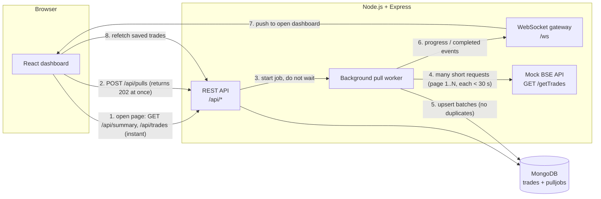
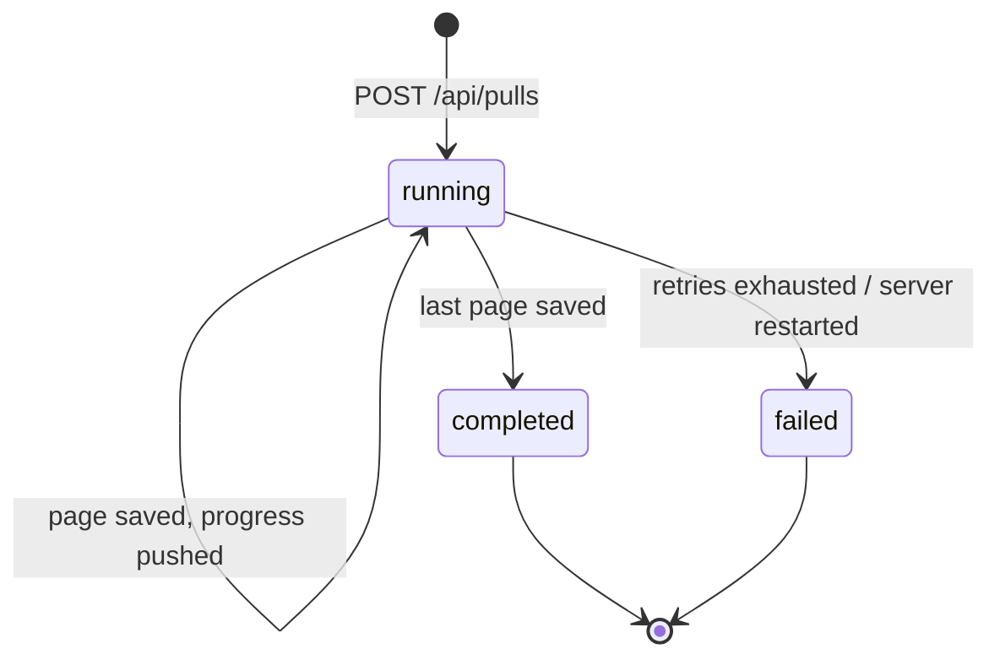

# Architecture

## Why no request lives longer than 30 seconds

| Request | Duration |
| --- | --- |
| `POST /api/pulls` | ~50 ms (answers `202`, work continues in background) |
| Worker → `GET /getTrades?page=N` | at most ~25 s (the 15 minute total is split across pages) |
| `GET /api/trades`, `/api/summary` | milliseconds, straight from MongoDB |
| `/ws` | a WebSocket (upgraded out of HTTP) with 20 s heartbeats and auto-reconnect |

## Pull lifecycle

