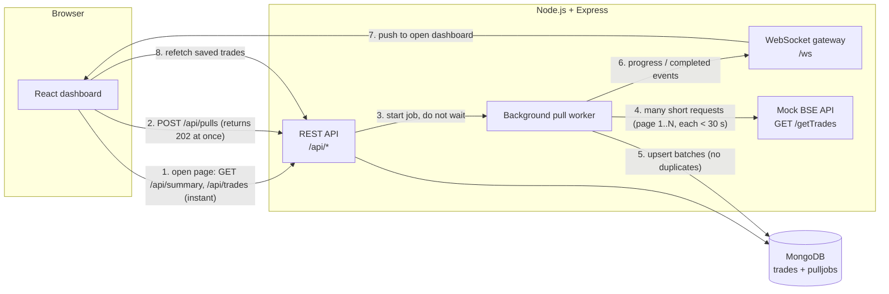
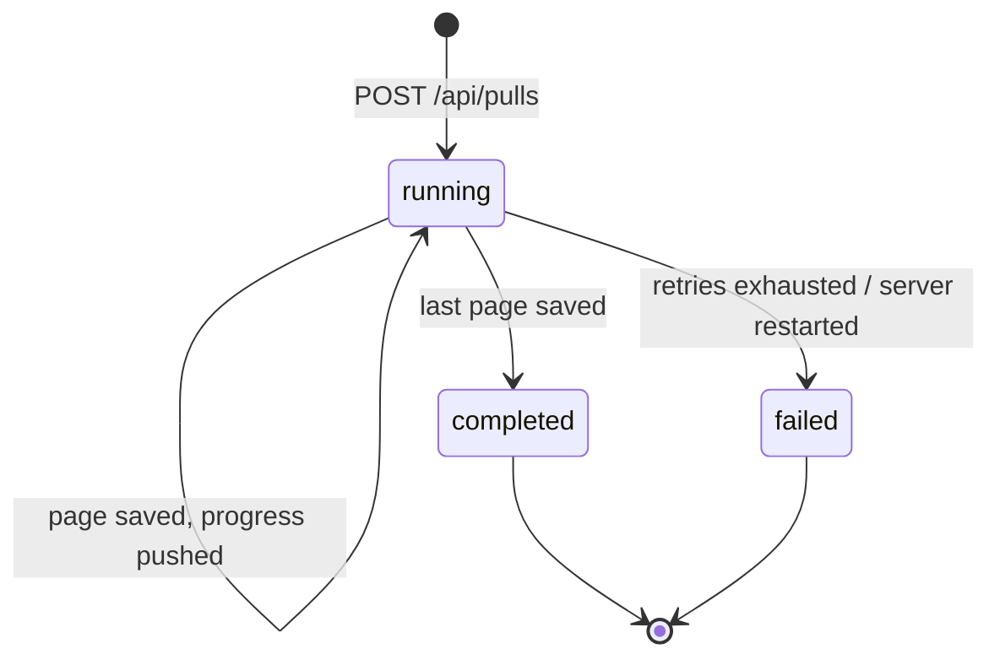

# Architecture note

**Problem:** a full BSE pull takes up to 15 minutes, but the network kills any HTTP request open for more than 30 seconds. The dashboard must open instantly and update itself with no refresh, no polling and no cron job.

**Design:**
1. The mock BSE API splits the total delay across pages, so every request finishes in under 25 seconds.
2. `POST /api/pulls` creates a job in MongoDB and returns immediately (202). A background worker fetches page by page and saves each batch.
3. The dashboard reads saved trades from MongoDB, so it opens instantly even during a pull.
4. The server pushes progress and completion events over a WebSocket, and the React app reloads the trades when they arrive.

**Why this design:**
- Short requests and a background worker avoid the 30-second limit.
- WebSocket instead of SSE, because SSE is a long-lived HTTP response that this network would cut. WebSocket is upgraded out of HTTP and uses heartbeats and auto-reconnect.
- A unique index on the trade ID plus upsert writes prevents duplicates, and a unique lock on running jobs allows only one pull at a time.
- Job state lives in MongoDB, so progress survives reloads. For several servers, the worker can move to BullMQ and Redis.

## Why no request lives longer than 30 seconds

| Request | Duration |
| --- | --- |
| `POST /api/pulls` | ~50 ms (answers `202`, work continues in background) |
| Worker → `GET /getTrades?page=N` | at most ~25 s (the 15 minute total is split across pages) |
| `GET /api/trades`, `/api/summary` | milliseconds, straight from MongoDB |
| `/ws` | a WebSocket (upgraded out of HTTP) with 20 s heartbeats and auto-reconnect |

## Pull lifecycle

